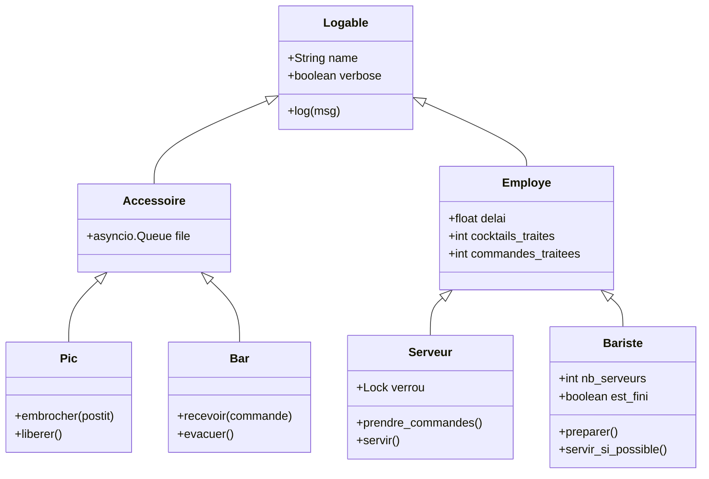

# 🍹 Bar à Cocktails - Simulation Concurrente

[](https://github.com/Daniele-Nana/bar_a_cocktails/actions/workflows/tests.yml)

Projet de programmation concurrente en Python (Master 2 Data Science).

## 📖 Description

Simulation du fonctionnement d'un bar à cocktails avec des serveurs et un bariste.

Le projet est divisé en deux parties :

1. **Version synchrone** (`src/borabora_sync.py`) : exécution séquentielle, lecture des commandes depuis un fichier.
2. **Version asynchrone** (`src/borabora_async.py`) : utilisation de `asyncio`, files `asyncio.Queue`, verrous (`asyncio.Lock`) et gestion de la concurrence.

## 🚀 Améliorations apportées (Bonus)

- **FIFO strict** : Implémentation respectant scrupuleusement l'ordre d'arrivée (Premier entré, Premier sorti).
- **Correction du `time.sleep()`** : Dans la version asynchrone, remplacement de `time.sleep()` par `await asyncio.sleep()` dans la classe `Clients` pour ne pas bloquer la boucle d'événements.
- **Type Hinting** : Typage complet des variables et des signatures de fonctions pour plus de robustesse.
- **Gestion des erreurs** : Utilisation de `try/except` pour la lecture des fichiers et validation des formats de lignes.
- **Tests unitaires** : Couverture de la logique FIFO et de la lecture de fichiers avec `pytest` (9 tests validés).
- **Logging** : Utilisation du module natif `logging` pour écrire dans des fichiers de log.
- **Affichage** : Utilisation de la bibliothèque `rich` pour générer un rapport de fin de service visuel dans le terminal.
- **Configuration** : Les délais et les modes verbeux sont externalisés dans un fichier `config.json`.
- **Interface CLI** : Utilisation de `argparse` pour une gestion professionnelle des arguments en ligne de commande.
- **Conteneurisation** : Un fichier `Dockerfile` est fourni pour exécuter le projet dans différents environnements.
- **CI/CD** : Un workflow GitHub Actions (`.github/workflows/tests.yml`) lance automatiquement les tests à chaque `push`.

## 🧩 Les Extensions (Partie 3)

Toutes les extensions demandées dans le sujet ont été implémentées dans `borabora_async.py` :

- **Extension 1 (Second serveur)** : Ajout de Clara (en plus d'Alice). Le bariste (Bob) gère l'envoi de deux sentinelles (`None`) pour arrêter proprement les deux serveurs.
- **Extension 2 (Productivité)** : Ajout d'un attribut `delai` pour chaque employé. Alice est plus lente (0.5 s), Clara est plus rapide (0.1 s) et Bob a un délai de 0.2 s.
- **Extension 3 (Aide du bariste)** : Le bariste possède une tâche `servir_si_possible()`. Lorsqu'il n'y a plus de post-it sur le pic, il aide les serveurs à évacuer le bar. Un mécanisme de nettoyage des sentinelles empêche les interblocages (*deadlocks*).

## 📂 Les données

Le dossier `commandes/` contient les fichiers de commandes :

- `commandes/lundi` : 2 commandes sans délai.
- `commandes/mardi` : 3 commandes avec des délais différents (0, 4 et 2 secondes).

**Format des commandes :**

```text
<delai> <conso1>,<conso2>,...
```

## ⚙️ Configuration (`config.json`)

Le fichier `config.json`, situé à la racine du projet, permet de régler le comportement des employés sans modifier le code :

```json
{
  "bob": {
    "delai": 0.2,
    "verbose": true
  },
  "alice": {
    "delai": 0.5,
    "verbose": true
  },
  "clara": {
    "delai": 0.1,
    "verbose": true
  }
}
```

## 🛠️ Installation

**Prérequis :** Python 3.10 ou supérieur.

### 1. Environnement virtuel

Créer un environnement virtuel :

```bash
python -m venv .venv
```

L'activer selon le système d'exploitation :

**Linux / macOS :**

```bash
source .venv/bin/activate
```

**Windows :**

```bash
.venv\Scripts\activate
```

### 2. Dépendances

Installer les dépendances nécessaires via le fichier `requirements.txt` :

```bash
pip install -r requirements.txt
```

Ou les installer manuellement :

```bash
pip install pytest pytest-asyncio pytest-cov rich
```

## 🏃‍♂️ Exécution

### Lancer la version synchrone

```bash
python src/borabora_sync.py commandes/lundi
```

### Lancer la version asynchrone (avec extensions)

```bash
python src/borabora_async.py commandes/mardi
```

**Astuce :** Utilisez `-h` ou `--help` pour afficher l'aide de `argparse`.

### Lancer les tests unitaires

```bash
pytest tests/ -v
```

**Résultat attendu : 9 tests passés avec succès.**

### Lancer avec Docker

Construire l'image Docker :

```bash
docker build -t bar-a-cocktails .
```

Lancer le conteneur :

```bash
docker run bar-a-cocktails
```

## 📸 Aperçu du rendu final

À la fin de chaque exécution, un rapport de fin de service est généré dans le terminal grâce à la bibliothèque `rich`.

Exemple de rendu :

```text
        🏁 RAPPORT DE FIN DE SERVICE (ASYNCHRONE)

┏━━━━━━━━━━━━━━━━━┳━━━━━━━━━━━━━━━━━━━┳━━━━━━━━━━━━━━━━━━━━┓
┃ Employé         ┃ Cocktails Traités ┃ Commandes Traitées ┃
┡━━━━━━━━━━━━━━━━━╇━━━━━━━━━━━━━━━━━━━╇━━━━━━━━━━━━━━━━━━━━┩
│ Bob (Bariste)   │ 13                │ 2                  │
│ Alice (Serveur) │ 6                 │ 1                  │
│ Clara (Serveur) │ 7                 │ 1                  │
└─────────────────┴───────────────────┴────────────────────┘

╭───────────────────────────────────────────────────────────────────────────╮
│ ⏱️ Temps total d'exécution : 6.24 secondes                                │
╰───────────────────────────────────────────────────────────────────────────╯
```

*Les valeurs ci-dessus illustrent un exemple de résultat.*

## 📊 Diagramme de classes (UML)


